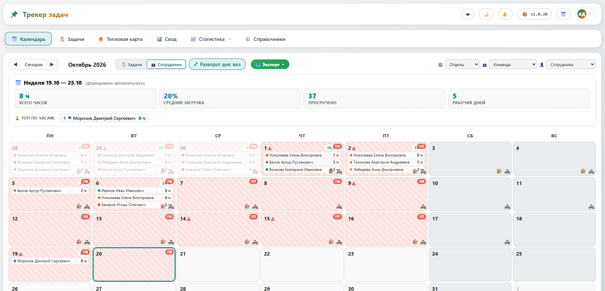

# Трекер задач

> Локальный учёт работы команды: календарь, задачи, отметки, отпуска и отчёты — без облака и сложных внедрений.

<!-- Картинку положите в репозиторий и раскомментируйте строку ниже (или замените путь):

-->

<p align="center">
  
</p>

---

## Зачем это

Система для небольших и средних команд, которым нужно:

- видеть **кто чем занят** по дням;
- вести **задачи** с исполнителями, сроками и статусами;
- быстро ставить **отметки** (часы / статус / комментарий);
- учитывать **отпуска, больничные, командировки**;
- выгружать **Excel** и смотреть сводки без Excel-ада.

Работает **локально** (или в корпоративной сети): Flask + SQLite, портативный Python в `runtime/`.

---

## Возможности

| Модуль | Что умеет |
|--------|-----------|
| **📅 Календарь** | Дни, отметки, «назначено, но не начато», копирование вчерашнего дня |
| **📋 Задачи** | Создание, назначение, сроки, срочность, карточка с историей работы |
| **🔥 Тепловая карта** | Нагрузка сотрудников и отделов |
| **📊 Свод / 📈 Статистика** | Часы, покрытие, просрочки, срезы по людям и задачам |
| **🏖 Отпуска** | Ручной ввод и **импорт из Excel** (листы по отделам) |
| **👤 Личный кабинет** | Свои задачи, отсутствия, норма отпуска |
| **🔔 Уведомления** | Вертикаль: сотрудник → руководитель команды / начальник отдела |
| **⚙️ Справочники** | Сотрудники, отделы, команды, права доступа |
| **🔌 Плагины** | Gantt, capacity, reminders, weekly report, auto-close overdue… |

---

## Быстрый старт

### Windows

1. Распакуйте архив / клонируйте репозиторий.
2. Запустите **`START.bat`** (или **`START_wheels.bat`**, если нужно поставить библиотеки из локальной папки).
3. Откройте в браузере: **http://localhost:5431/**

При первом запуске создаётся админ (пароль смотрите в консоли сервера — смените после входа).

### Если Python «свой»

```bat
cd core
..\runtime\embedded\python313\python.exe run.py
